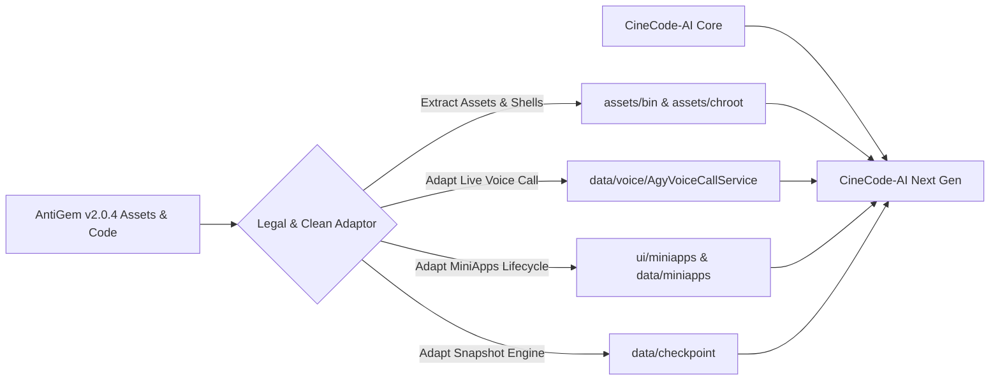

# CineCode-AI vs AntiGem v2.0.4 — Architectural & Feature Comparison

This document provides a comprehensive side-by-side technical evaluation between **CineCode-AI** (current state) and **AntiGem v2.0.4** (decompiled state).

---

## 1. High-Level Comparison Matrix

| Feature / Domain | CineCode-AI (Current) | AntiGem v2.0.4 | Verdict & Strategy for CineCode-AI |
|---|---|---|---|
| **Primary Language** | Modern Kotlin (2.3.20) | Decompiled Java / Kotlin (2.x) | **Preserve Kotlin**: Keep CineCode-AI's native Kotlin codebase. |
| **Code Editor** | Sora Editor (syntax highlighting, native gestures) | Monocle / WebView based IDE bridge | **CineCode Superior**: Sora Editor provides superior mobile text editing. |
| **Video & Creator Studio** | `CineCameraDirector`, `CineCodeSkillsMcp`, `TurboHindiNormalizer` | Google Flow extension (`flow-client.js`, `flow-workflows.js`) | **Combine Both**: Merge CineCode's Indian/Cinematic camera director with AntiGem's Google Flow workflows. |
| **Voice Interaction** | Jarvis Controller, STT listener, `MyraaAssistantView` | `AgyVoiceCallService` (persistent audio stream, Quick Tile, `JarvisTalkActivity`) | **Upgrade CineCode**: Integrate AntiGem's low-latency foreground voice call service & full visualizer. |
| **AI Agent Protocols** | Claude CLI, Codex CLI, OpenCode CLI, Antigravity | Claude MCP runtime, OpenCode, Codex, Antigravity | **Enhance**: Add unified provider settings and multi-turn agent streaming. |
| **Terminal & PTY** | Termux terminal emulator view + wire-daemon gRPC | Direct `TermuxService` + `libtermux.so` PTY bindings | **Harmonize**: Support both direct PTY execution and gRPC daemon bridge. |
| **MiniApps Ecosystem** | Basic `MiniAppsScreen` | Full 7-Activity lifecycle (`Store`, `Install`, `Launch`, `Share`, `Alarms`, `Boot`) | **Adopt from AntiGem**: Integrate full MiniApp store and background worker hooks. |
| **Checkpoint & Rollback** | Basic `ProjectCheckpoints` | Full multi-file snapshot & diff rollback engine (`TurnResult`, `CheckpointPreview`) | **Adopt from AntiGem**: Integrate granular file snapshotting and rollback. |
| **Backup & Restore** | Shell script stubs | Complete `assets/bin/` backup & restore suite (`backup_chats`, `restore_chats`, `git_clone`) | **Adopt from AntiGem**: Add the production-tested backup/restore shell suite. |
| **Linux Chroot Support** | Basic environment manager | `assets/chroot/chrootctl.sh` proot/chroot container manager | **Adopt from AntiGem**: Bundle `chrootctl.sh` for multi-distribution Linux containers. |
| **LaTeX & Math** | JLatexMath (`ru.noties:jlatexmath-android:0.2.0`) | Scilab JLatexMath + complete TTF font asset collection | **Synergize**: Retain library dependency and ensure all font assets are present. |

---

## 2. Reusable Components from AntiGem v2.0.4

### A. Core Background Services
1. **`AgyVoiceCallService`**:
   - High-performance foreground service with `FOREGROUND_SERVICE_MICROPHONE`.
   - Real-time continuous two-way audio streaming for hands-free AI interaction.
   - Handles audio focus, low latency playback, and speech interruption.
2. **`MiniApp` Lifecycle Components**:
   - `MiniAppNotificationReceiver`: Handles interactive notification actions.
   - `MiniAppAlarmReceiver`: Executes scheduled tasks even when the main app is closed.
   - `MiniAppBootReceiver`: Re-arms scheduled jobs upon device restart.
   - `MiniAppInstallActivity`: Safe user confirmation and manifest permission review.

### B. Shell & Automation Assets
1. **`assets/bin/backup_chats` & `restore_chats`**:
   - Robust JSONL chat trajectory exporter/importer.
2. **`assets/bin/backup_projects` & `restore_projects`**:
   - Tar-based snapshot archiving for project workspaces.
3. **`assets/chroot/chrootctl.sh`**:
   - Advanced container script for launching Debian, Ubuntu, or Alpine chroot/proot environments inside Android.
4. **`assets/browser-extensions/google-flow/`**:
   - WebExtension bridge for automating Google Flow and AI Studio tasks.

---

## 3. CineCode-AI's Unique Strengths to Preserve & Elevate

1. **Native Sora Code Editor (`io.github.Rosemoe.sora-editor`)**:
   - Native hardware-accelerated code rendering.
   - Pinch-to-zoom font scaling, line numbering, bracket matching.
   - Far smoother on touchscreens than WebView-based Monaco editors.
2. **CineCode Creator Studio & Camera Director**:
   - `CineCameraDirector`: Industry-grade 3D camera motion parameters (Dolly, Crane, Orbit) and volumetric lighting (Divine Golden, Vedic Dawn, Cosmic Astral).
   - `TurboHindiNormalizer`: Phonetic cleanup for realistic Hindi/Hinglish voiceover synthesis.
3. **Self-Healing Code Execution Engine**:
   - Real-time terminal log scanning for tracebacks, syntax errors, and missing dependencies with auto-patching prompts.
4. **Clean Kotlin 2.x Architecture**:
   - Idiomatic coroutines, StateFlow, Compose state hoisting, and type-safe navigation.

---

## 4. Gap Analysis & Integration Strategy

### Strategic Decisions:
1. **Do Not Regress Kotlin to Java**: Keep CineCode's existing Kotlin code. Port any missing AntiGem features cleanly into Kotlin.
2. **Preserve Package Declarations**: Maintain `com.shriram.cinecode.*` across all modules.
3. **Zero Hardcoded Secrets**: Maintain the secure dynamic API management paradigm via DataStore.
