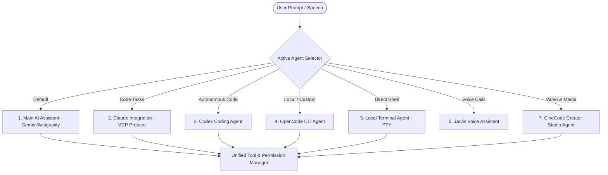

# CineCode-AI — Implementation Roadmap (Phases 2 to 9)

This roadmap outlines the systematic execution plan to elevate **CineCode-AI** into an industry-grade Android AI development platform and video creation studio.

---

## 📌 Phase 2 — Project Preservation & Safety Baseline

> [!IMPORTANT]
> **Safety Rule**: Never modify or overwrite working code without creating a dedicated Git checkpoint. Preserve existing package structure and working modules.

- [ ] **Step 2.1 — Branch Creation**:
  - Create and switch to a dedicated development branch: `git checkout -b feature/cinecode-v2-upgrade`.
- [ ] **Step 2.2 — Baseline Verification**:
  - Verify that the cloned repository compiles cleanly under Gradle (`./gradlew assembleDebug` or `:app:compileDebugKotlin`).
  - Document any baseline warnings or environment prerequisites.
- [ ] **Step 2.3 — Non-Destructive Workspace Setup**:
  - Maintain all existing assets, layouts, and Kotlin files in place.

---

## 🤖 Phase 3 — Modular Multi-Agent AI System

Develop a unified multi-agent architecture with streaming responses, conversation persistence, and safe tool execution.

- [ ] **Step 3.1 — Unified Agent Selector & Preferences**:
  - Implement a clean dropdown / bottom-sheet for switching between the 7 agents.
  - Store per-agent configurations (temperature, system prompt, model ID) in DataStore.
- [ ] **Step 3.2 — Claude & MCP Runtime Refinement**:
  - Ensure full MCP tool call streaming and approval accordions.
- [ ] **Step 3.3 — Codex & OpenCode Integration**:
  - Wire custom model providers and streaming delta parsing.
- [ ] **Step 3.4 — Local Terminal Agent**:
  - Dedicated agent capable of running bash commands with auto-healing feedback.
- [ ] **Step 3.5 — Context & History Persistence**:
  - Save full conversation trajectories in JSONL format with rollback support.

---

## ⚡ Phase 4 — Advanced Android & System Features

Adopt and upgrade Android system-level capabilities derived from the AntiGem architecture.

- [ ] **Step 4.1 — Embedded Linux Terminal & PTY**:
  - Ensure native `libtermux.so` PTY bindings are active for direct subshell execution alongside the gRPC daemon.
- [ ] **Step 4.2 — Floating AI Chat Bubble (`FloatingChatActivity`)**:
  - Implement the `SYSTEM_ALERT_WINDOW` floating chat bubble with minimize/expand gestures.
- [ ] **Step 4.3 — Checkpoints & Project Snapshots**:
  - Implement `ProjectCheckpoints` snapshotting to track file diffs before and after agent modifications.
- [ ] **Step 4.4 — Production Backup & Restore Suite**:
  - Bundle `assets/bin/backup_chats`, `restore_chats`, `backup_projects`, `restore_projects`, and `git_clone`.
- [ ] **Step 4.5 — Linux Chroot Container Manager (`chrootctl.sh`)**:
  - Integrate `assets/chroot/chrootctl.sh` into `assets/chroot/` for launching full Linux distros.
- [ ] **Step 4.6 — Mini-Apps Ecosystem Expansion**:
  - Implement full lifecycle receivers: `MiniAppNotificationReceiver`, `MiniAppAlarmReceiver`, `MiniAppBootReceiver`.
  - Provide sandboxed WebView container with JavaScript bridge.
- [ ] **Step 4.7 — Accessibility Automation (`AutomationAccessibilityService`)**:
  - Configure screen tree inspection, automated gestures, and screenshot capture with explicit runtime consent.
- [ ] **Step 4.8 — Wireless ADB Client (`AdbPairingService`)**:
  - Support Android 11+ wireless ADB pairing for rootless debugging.

---

## 🎙️ Phase 5 — Jarvis Voice Assistant Upgrade

Build an industry-grade, bilingual voice assistant with real-time speech streaming.

- [ ] **Step 5.1 — Real-Time Live Audio Service (`AgyVoiceCallService`)**:
  - Implement foreground service with `FOREGROUND_SERVICE_MICROPHONE`.
  - Continuous two-way streaming: low-latency microphone capture + TTS streaming playback.
- [ ] **Step 5.2 — Multilingual Support**:
  - Full support for Hindi, Hinglish, and English speech recognition and natural voice synthesis.
  - Integrate `TurboHindiNormalizer` for phonetic speech rendering.
- [ ] **Step 5.3 — Dynamic Waveform Visualizer (`JarvisTalkActivity`)**:
  - Fullscreen voice interaction UI with animated audio waves and real-time transcription.
- [ ] **Step 5.4 — Quick Settings Tiles**:
  - Provide `JarvisTileService` and `VoiceCallTileService` in Android notification shade.

---

## 🎬 Phase 6 — CineCode Video Creation Studio

Expand the existing video and creator tools into a complete multimedia studio.

- [ ] **Step 6.1 — AI Video Script & Scene Planning**:
  - Generate structured scenes with dialogue, action descriptions, and camera cues.
- [ ] **Step 6.2 — 3D Cinematic & Mythological Camera Director**:
  - Integrate `CineCameraDirector` (Dolly, Crane, Orbit, Divine Golden, Vedic Dawn lighting).
  - Connect with Google Flow extension workflows (`flow-workflows.js`, `storyboard-analyzer.js`).
- [ ] **Step 6.3 — AI Video Prompt Generation**:
  - Generate optimized prompts for video diffusion models (Sora, Veo, Kling, Runway).
- [ ] **Step 6.4 — Timeline & Asset Management**:
  - Organize scene audio, generated images, background music, and subtitle tracks.
- [ ] **Step 6.5 — Video Rendering & Export Pipeline**:
  - Automate FFmpeg command generation for stitching scenes, subtitles, and audio.

---

## 🎨 Phase 7 — Professional UI/UX & Design System

Create a developer-focused, modern UI inspired by Google Developer platforms.

- [ ] **Step 7.1 — Design System & Themes**:
  - Complete Dark and Light Material 3 color schemes.
  - Monospace typography for coding areas, modern sans-serif for conversation.
- [ ] **Step 7.2 — Code Editor Enhancement**:
  - Polish Sora Editor toolbar with code action chips (Run, Format, Diff, Save).
- [ ] **Step 7.3 — Unified Navigation**:
  - Navigation 3 bar switching between **Chat**, **IDE**, **Terminal**, **Video Studio**, and **Settings**.
- [ ] **Step 7.4 — Secure API Settings Hub**:
  - Dedicated settings screen for managing Anthropic, Gemini, OpenAI, and GitHub tokens with masking (`••••••••`).

---

## ⚙️ Phase 8 — Technical Architecture & Dependency Harmonization

- [ ] **Step 8.1 — Dependency Audit**:
  - Verify and align versions in `gradle/libs.versions.toml`.
  - Harmonize Jetpack Compose (BOM 2026.03.01 / 1.13.0) and Kotlin (2.3.20).
- [ ] **Step 8.2 — NDK & ABI Compatibility**:
  - Ensure `arm64-v8a` and `armeabi-v7a` native binaries are correctly packaged.

---

## 🧪 Phase 9 — Testing, Verification & GitHub Actions CI

- [ ] **Step 9.1 — Local Build & Unit Testing**:
  - Compile Android project (`./gradlew assembleDebug`).
  - Run unit tests and verify zero regressions.
- [ ] **Step 9.2 — End-to-End Feature Testing**:
  - Test agent streaming, terminal emulator, voice calls, and code editor.
- [ ] **Step 9.3 — CI/CD Pipeline Verification**:
  - Verify GitHub Actions workflow for automatic APK builds.
