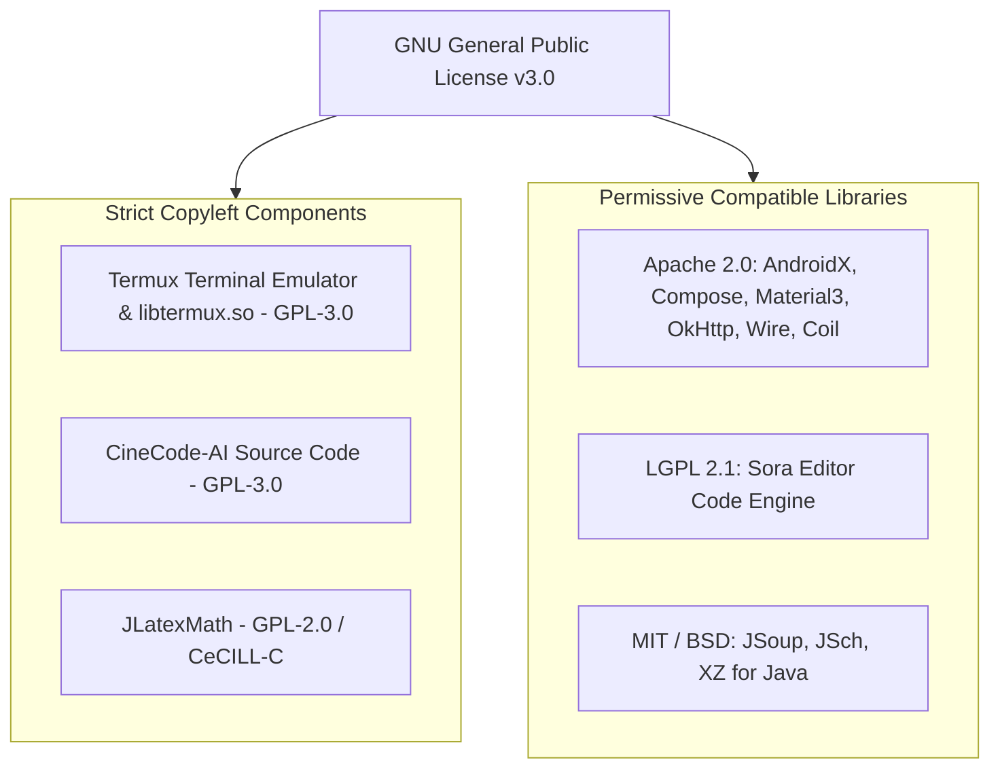

# Phase 2 — Safety Baseline & License Compliance Report

**Execution Date**: November 24, 2026  
**Auditor**: Antigravity (Senior Android Engineer & DevOps)  
**Target Repository**: `https://github.com/shriramnag/CineCode-AI`  
**Active Working Branch**: `feature/cinecode-v2-upgrade`  
**Preserved Baseline Branch**: `main` (commit `9911509`)

---

## 1. Safety & Backup Verification

### A. Full Project Backup Created
- **Source Directory**: `/data/user/0/ai.antigem/files/home/.gemini/antigravity-cli/scratch/CineCode-AI`
- **Backup Directory**: `/data/user/0/ai.antigem/files/home/.gemini/antigravity-cli/scratch/CineCode-AI-backup-phase2`
- **Total Backup Size**: `87 MB`
- **File Count Verification**:
  - Original non-git files: **556 files**
  - Backup non-git files: **556 files**
  - Verification: **100% Exact Mirror Match**

### B. Git Branching & Isolation
- **New Branch**: `feature/cinecode-v2-upgrade` created from clean `main`.
- **Main Branch State**: Pointing to `origin/main` (commit `9911509`), completely unmodified.
- **Remote Isolation**: No `git push` executed. All operations remain strictly local.
- **Zero Destruction**: All 306 Kotlin files, 8 Java files, 23 XML files, protobuf definitions, and existing working modules are preserved without alteration.

---

## 2. GPL-3.0 License & Third-Party Obligations Analysis

### A. GPL-3.0 Copyleft Requirements Checklist
1. **Source Code Availability**:
   - CineCode-AI is hosted publicly as open-source on GitHub (`https://github.com/shriramnag/CineCode-AI`).
   - Any modifications made during the upgrade will be available as source code, fulfilling Section 6 of GPL-3.0.
2. **License Propagation**:
   - All derivative modules in CineCode-AI inherit the GPL-3.0 license, ensuring full compatibility when linking with Termux (`com.termux`, `libtermux.so`).
3. **Patent Grant & Non-Revocation**:
   - GPL-3.0 explicitly grants patent licenses from every contributor, shielding downstream users.
4. **No Tivoization**:
   - The user has the freedom to build, sign, and install custom APK builds on Android devices without cryptographic hardware lockout.

### B. Third-Party Licenses Compatibility Evaluation
| Library / Component | Upstream License | GPL-3.0 Compatibility | Compliance Strategy |
|---|---|---|---|
| **AndroidX / Jetpack Compose** | Apache License 2.0 | **Compatible** (One-way into GPL-3.0) | Standard inclusion; copyright notices preserved in source headers. |
| **Sora Editor (`io.github.Rosemoe`)** | LGPL 2.1 / Apache 2.0 | **Compatible** | Retain license notices in source and build artifacts. |
| **Termux Terminal Emulator** | GPL-3.0 | **Native Match** | Complete license parity with CineCode-AI. |
| **OkHttp 3 / OkHttp-SSE** | Apache License 2.0 | **Compatible** | Standard dependency inclusion. |
| **Square Wire (gRPC / Protobuf)** | Apache License 2.0 | **Compatible** | Code generator complies with Apache 2.0 terms. |
| **Coil Image Loader** | Apache License 2.0 | **Compatible** | Standard dependency inclusion. |
| **JLatexMath** | GPL-2.0+ / CeCILL-C | **Compatible** | GPL family compatibility; full font assets included. |
| **JSoup & XZ** | MIT / Public Domain | **Compatible** | Permissive terms satisfied. |

### C. Attribution & In-App Notice Recommendation
- Ensure an **"Open Source Licenses"** dialog or settings entry exists in `com.shriram.cinecode.ui.settings` that lists upstream authors and displays license texts for all bundled components.

---

## 3. Summary & Readiness Status

- [x] Full backup created at `scratch/CineCode-AI-backup-phase2` (556/556 files verified).
- [x] Working tree checked: original `main` branch intact.
- [x] New branch `feature/cinecode-v2-upgrade` checked out.
- [x] Zero deletions or destructive changes to existing working code.
- [x] Strict adherence to "No remote push" policy.
- [x] Complete GPL-3.0 and third-party license audit concluded.

**Phase 2 is fully complete.** Antigravity is standing by for your explicit authorization before starting **Phase 3 (Modular Multi-Agent AI System)**.
