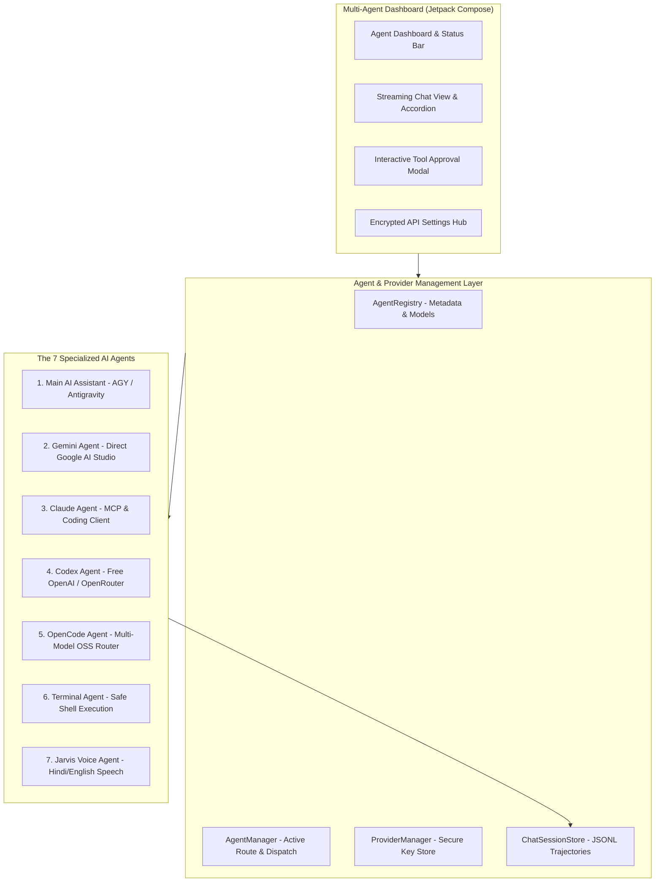

# Phase 3 — Modular Multi-Agent AI System Architecture

**Project**: CineCode-AI  
**Active Branch**: `feature/cinecode-v2-upgrade`  
**Document**: Architectural Blueprint & Specification

---

## 1. Architectural Overview

The CineCode-AI Multi-Agent System provides a modular, pluggable architecture where **7 specialized AI agents** operate independently, each with dedicated configuration, provider credentials, streaming protocols, and conversation histories.



---

## 2. The Seven Specialized Agents

| # | Agent Identifier | Kind Enum | Role & Core Specialization | Default Model / Backend |
|---|---|---|---|---|
| **1** | **Main AI Assistant** | `AGY` | General coding, workspace reasoning, project coordination | Gemini 3.8 / Hybrid Antigravity |
| **2** | **Gemini Agent** | `GEMINI` | High-speed multimodal analysis, deep reasoning, Hindi/Hinglish | `gemini-2.0-flash` / `gemini-1.5-pro` |
| **3** | **Claude Agent** | `CLAUDE` | Agentic refactoring, MCP tools execution, autonomous code patching | Claude 3.5 Sonnet / Haiku |
| **4** | **Codex Coding Agent** | `CODEX` | Fast code generation, unit test creation, algorithm design | OpenAI / DeepSeek / Groq |
| **5** | **OpenCode Agent** | `OPENCODE` | Free open-source models, local Ollama endpoints | Llama 3.3 / Qwen 2.5 / Mistral |
| **6** | **Terminal Agent** | `TERMINAL` | Safe Linux shell command generation & execution with user approval | PTY / Bash / Termux Engine |
| **7** | **Jarvis Voice Agent** | `JARVIS` | Real-time hands-free speech interaction, device automation | Low-Latency Live Voice Engine |

---

## 3. Core Component Specifications

### A. Common Agent Interface (`AgentChatBackend`)
Every agent implements the standardized `AgentChatBackend` contract:
```kotlin
interface AgentChatBackend {
    val kind: AgentKind
    val conversations: StateFlow<List<Conversation>>
    val currentConversation: StateFlow<Conversation?>
    val messages: StateFlow<List<ChatMessage>>
    val isStreaming: StateFlow<Boolean>
    val isLoadingConversation: StateFlow<Boolean>
    val conversationError: StateFlow<String?>

    fun startNewChat()
    fun selectConversation(id: String)
    fun sendMessage(content: String)
    fun stopStreaming()
    fun deleteConversation(id: String)
    fun forkConversation(id: String)
    fun retryConnections()
    fun onAppForegrounded()
}
```

### B. Agent Registry (`AgentRegistry`)
A declarative registry holding metadata for all agents:
- Title, display subtitle, badge emoji, and icon.
- List of supported model families and model IDs.
- System prompt templates tailored for coding, terminal safety, voice, and multimodal tasks.
- Hardware requirements (RAM profile, offline vs cloud availability).

### C. Provider Manager (`ProviderManager`)
A centralized credential and endpoint manager:
- Manages API keys for:
  - Google AI Studio (`GEMINI_API_KEY`)
  - Anthropic (`ANTHROPIC_API_KEY`)
  - OpenRouter / Groq / OpenAI
  - Local Ollama host (`http://127.0.0.1:11434`)
- Secure private DataStore storage with instant validation.
- Zero credential logging or exposure.

### D. Gemini Agent (`GeminiChatBackend`) — Implementation Details
- **API Endpoint**: `https://generativelanguage.googleapis.com/v1beta/models/{model}:streamGenerateContent?alt=sse&key={apiKey}`
- **Streaming Parser**: Real-time Server-Sent Events (SSE) parsing chunk by chunk.
- **Multilingual Support**: Built-in Hindi, Hinglish, and English reasoning directives.
- **Persistence**: Integrates directly into `ChatSessionStore` for automatic JSONL saving and history loading.
- **Robust Error Handling**: HTTP 429 rate limit exponential backoff, network timeout recovery, and friendly user error states.

### E. Terminal Agent (`TerminalChatBackend`) — Safety Gate
- When the user asks to run commands, the Terminal Agent formulates the shell script.
- **Mandatory User Approval**: Displays an interactive approval card with the exact command string before execution.
- Returns stdout, stderr, and exit code directly into the chat trajectory with self-healing triggers.

---

## 4. UI Dashboard Architecture

The Multi-Agent Dashboard integrates into the top bar and chat view:
1. **Agent Quick-Switcher**: Visual carousel/chips showing active agent icon and status (Online / Ready / Offline).
2. **Model Selector Bottom Sheet**: Displays models specific to the active agent.
3. **API Key Setup Modal**: Appears seamlessly if an agent is selected whose key is missing.
4. **Tool Approval Sheet**: Clear visual preview of tool calls, file writes, and shell commands.
